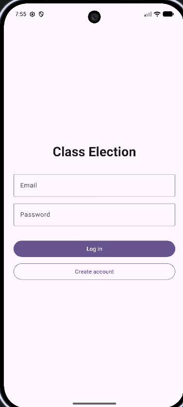
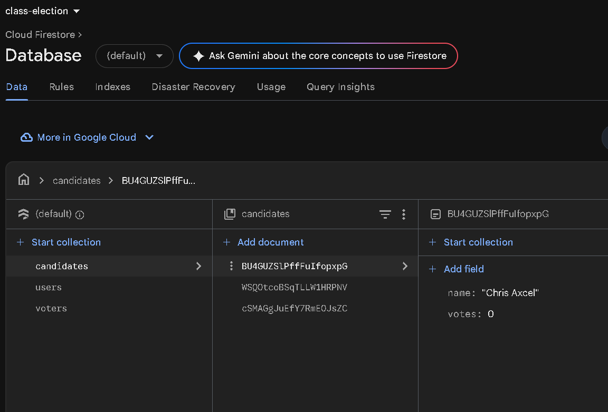
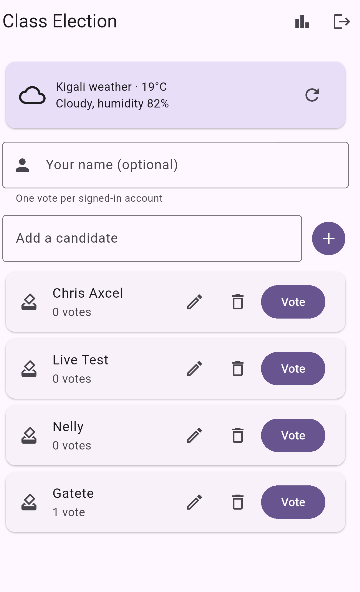
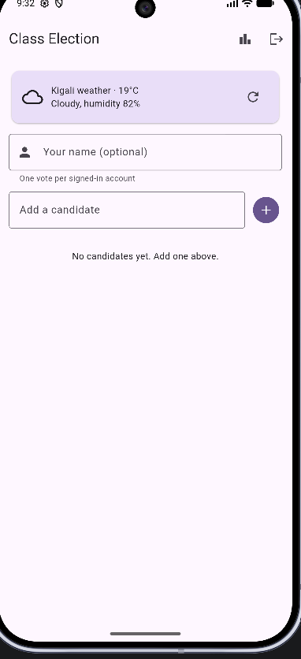
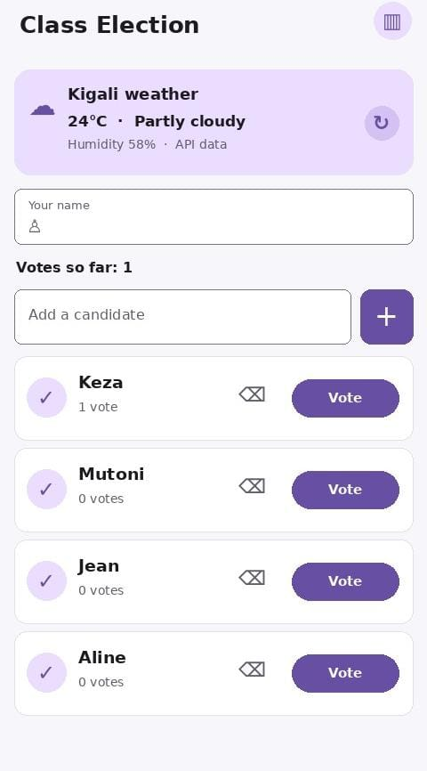
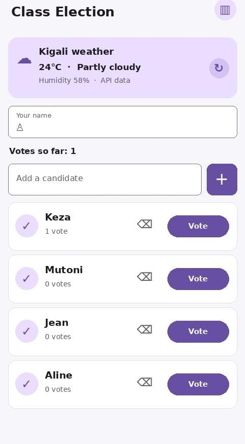
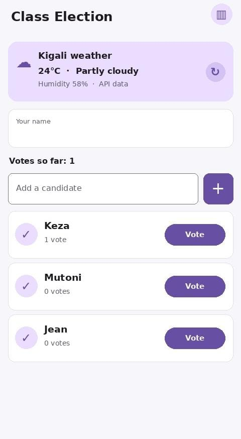
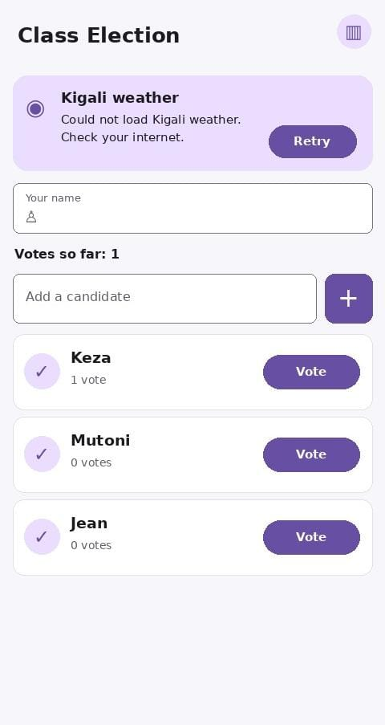

# Class Election

Class Election is a voting app for a class: students type their name and vote for one candidate, and the app ranks the results and reports a winner or a tie. It signs users in with Firebase Authentication, and each user's data is saved in Cloud Firestore under their own id, so two accounts never see each other's data, and every change appears live.

## Features

- Create an account, log in and log out with email and password, with clear messages for wrong input
- Candidates and voters saved in Cloud Firestore under users/{id}/candidates and users/{id}/voters
- Live updates: a change in Firestore appears in the app without a refresh
- Names are cleaned (spaces removed, Title Case), and each voter name can vote only once
- Add, rename and delete candidates, with an Are you sure? dialog and an Undo message
- A candidate with votes cannot be removed
- Results screen with vote totals and candidate rankings
- Kigali weather from the Open-Meteo API, with loading, error and Retry states
- Loading, error and empty states on the voting screen
- Firestore rules: a signed-in user can only read and write their own data

## Screenshots

## Run the app

1. Install Flutter and an Android emulator, or connect an Android phone.
2. Create your own Firebase project with Email/Password sign-in and Cloud Firestore, register the Android app, and put your google-services.json in android/app/.
3. Publish these Firestore rules:

rules_version = '2';
service cloud.firestore {
match /databases/{database}/documents {
match /users/{userId}/{document=**} {
allow read, write: if request.auth != null && request.auth.uid == userId;
}
}
}

4. Run flutter pub get.
5. Run flutter run.

---

## Previous version: data saved on the phone (Session 5)

Before Firebase, candidate data and voter names were saved on the phone with shared_preferences, so they remained after the app closed. Kigali weather from Open-Meteo was added in this version. Firestore replaced shared_preferences for the main data in Session 6.

> **Preview notice:** The four images below are illustrative mobile-screen mockups prepared for planning on a phone. They are not screenshots captured from a running emulator. Replace them with real app captures before submitting the assignment. The API values shown are illustrative, not verified live readings.

