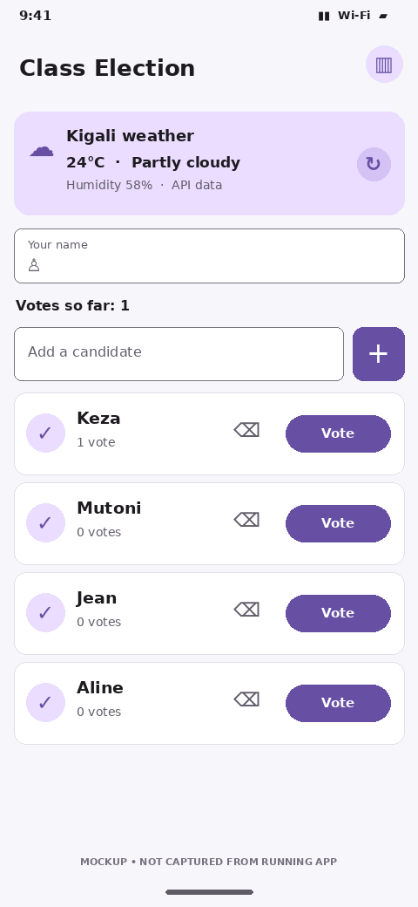
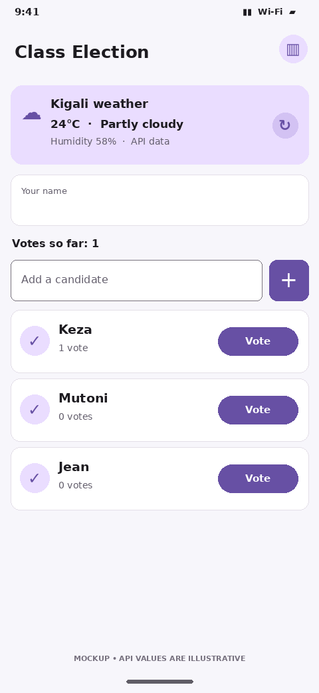
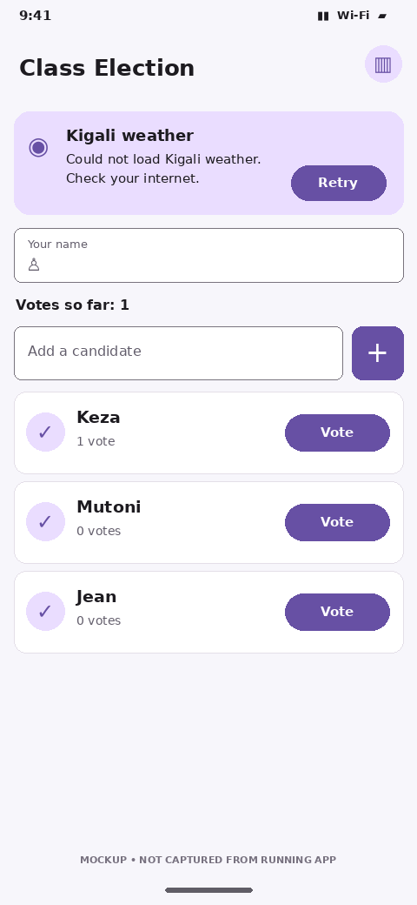

# Class Election

A Flutter mini project for class voting. Students can add candidates, cast one vote per voter name, view results, and see Kigali weather from the Open-Meteo API. Candidate data and voter names are saved on the phone with `shared_preferences`, so they remain after the app closes.

## Screenshots

> **Preview notice:** The four images below are illustrative mobile-screen mockups prepared for planning on a phone. They are not screenshots captured from a running emulator. Replace them with real app captures before submitting the assignment. The API values shown are illustrative, not verified live readings.

## Run the app

1. Install Flutter and an Android emulator or connect an Android phone.
2. Run `flutter pub get`.
3. Run `flutter run`.

## Features

- Add and remove candidates.
- Record votes and prevent the same voter name from voting twice.
- Save candidates and voter names using `shared_preferences`.
- Display Kigali weather from Open-Meteo with loading, error, and Retry states.
- View vote totals and candidate rankings.
